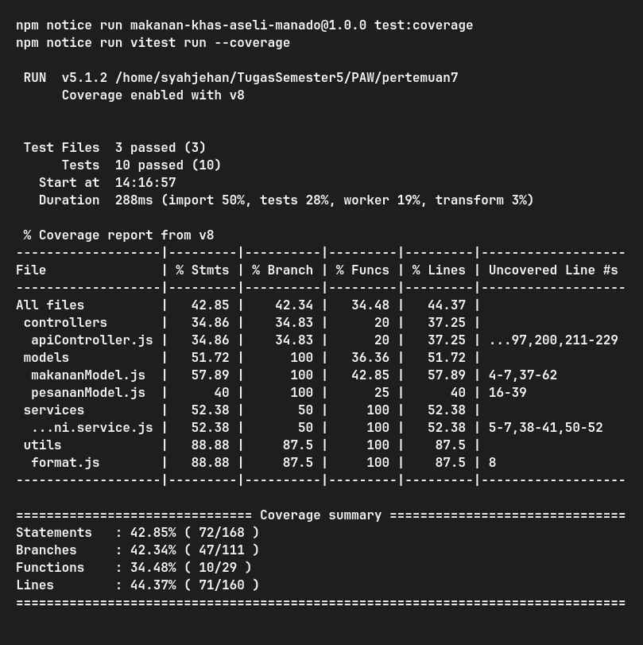

# Tugas Week 11 — Unit Testing, Integration Testing, dan Coverage

Pengujian dilanjutkan pada project Week 7 yang sama. Vitest digunakan sebagai test runner dan Supertest mengirim HTTP request ke Express app. Integration test memakai stub untuk database PostgreSQL dan respons API Gemini, sehingga data aplikasi utama tidak berubah dan test tidak memerlukan kredensial layanan eksternal.

## Unit testing

Unit test mencakup format harga Rupiah dan pencarian katalog makanan. Query database di-stub untuk menguji pencarian tanpa mengakses database sungguhan.

Perintah: `npm run test:unit` — **2 file, 6 test lulus**.

## Integration testing

Integration test mengirim request ke `/api/chat` dan `/api/pesanan`, mencakup sapaan, validasi input, alur chat sampai service Gemini, penolakan pesanan tidak valid, dan penyimpanan pesanan dengan total harga yang dihitung controller.

Perintah: `npm run test:integration` — **1 file, 4 test lulus**.

## Code coverage

Perintah: `npm run test:coverage` — **3 file, 10 test lulus**.

| Jenis coverage | Hasil |
| --- | ---: |
| Statements | 42.85% (72/168) |
| Branches | 42.34% (47/111) |
| Functions | 34.48% (10/29) |
| Lines | 44.37% (71/160) |

Coverage masih menunjukkan banyak alur controller dan model yang belum diuji, terutama CRUD produk, status pesanan, dan kondisi gagal service. Hasil berikut adalah laporan seluruh file yang dipilih pada `vitest.config.js`.

## Struktur test

- `tests/unit/utils/format.test.js`: format nilai Rupiah dan input yang tidak dapat dibaca.
- `tests/unit/models/makananModel.test.js`: pencarian berdasarkan nama, pencarian katalog, pertanyaan lain, dan katalog kosong.
- `tests/integration/chat.test.js`: endpoint chat dan pembuatan pesanan melalui Express route, controller, model, serta service.
- `tests/fixtures/products.js`: data produk bersama untuk test.
- `vitest.config.js`: environment Node dan konfigurasi coverage v8.

Jalankan seluruh test dengan `npm test`. Untuk mengulang laporan coverage, gunakan `npm run test:coverage`.
